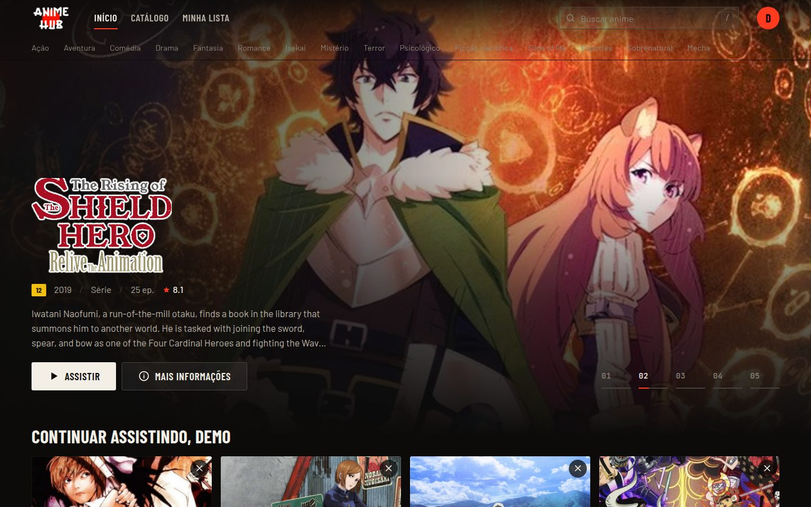
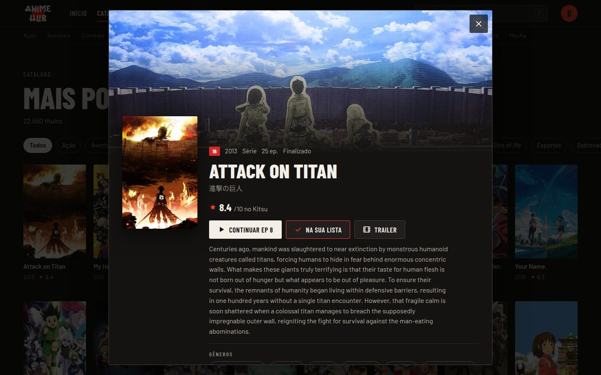

<div align="center">


# AnimeHub

Anime catalog with user accounts, **My list** and **Continue watching**.


</div>

<br>



## Features

- Browse rows of **Trending**, **Airing now** and by genre (action, romance, isekai...)
- Search any anime and filter the catalog by genre
- See details: synopsis, rating, age rating, genres, trailer and where to watch officially
- Create an account and log in
- Save anime to **My list**
- Open episodes (with thumbnail and synopsis); the site remembers where you stopped and shows it in **Continue watching**
- Episode player ready on the front end, with episode list, previous/next and autoplay (the video source isn't wired up yet, see [Player](#player))

Anime data comes from the public [Kitsu](https://kitsu.app) API. Accounts, lists and progress live in our own database.

> The interface is in Portuguese.

<br>





<p align="center">
  
</p>

<br>

## Using the site

### Home
- At the top is the **spotlight**: five anime that rotate on their own. Hover to pause, or click the numbers to pick one.
- Below come the rows: **Trending now** (top 10), **Airing now** and one per genre. Drag sideways or use the arrows.
- Once you're logged in, a **Continue watching** row also shows up, with the last episode you opened of each anime. The **×** removes the anime from the row.

### Search and filter
- Type in the **Search anime** field at the top. Press **/** on any page to jump straight to search.
- In the **Catalog**, the genre buttons filter the list. **Load more** brings more results.
- The genre bar under the header goes straight to the filtered catalog.

### Anime details
Click any poster to open the details: synopsis, rating, age rating, genres and where to watch officially. From there you can:
- **Watch**: opens the anime page. If you've already seen an episode, the button becomes **Continue EP X**.
- **My list**: saves or removes the anime from your list.
- **Trailer**: plays the official trailer inside the window.

### Watch
- The watch page has the player, the episode title, the synopsis and **Previous** / **Next** buttons.
- Below is the episode list with thumbnails. Click an episode to switch without reloading the page. Long series are split into ranges of 20 (EP 1–20, 21–40...).
- Every episode you open is saved to **Continue watching**.
- With no video source wired up, the player shows a "no video yet" notice and a button to the trailer (see [Player](#player)).

### Account
- **Log in → Create account**: name, email and a password with at least 8 characters. You're logged in right after signing up.
- Watching, saving to your list and keeping progress require login. Sessions last 7 days.
- To log out, click your initial in the corner of the header (on mobile it's in the ☰ menu), then **Log out**.

### My list
In the menu, **My list** shows every anime you've saved.

<br>

## How to run

### 1. Install Docker

- **Windows / Mac:** [Docker Desktop](https://www.docker.com/products/docker-desktop/)
- **Linux:** Docker Engine + the Compose plugin (`docker compose version` must work)

No need to install PHP, Apache or MySQL. Everything runs inside the containers.

### 2. Start the project

Inside the project folder:

```bash
docker compose up -d --build
```

The first run takes a while (it pulls the images and creates the database). After that it's quick.

### 3. Open it in the browser

**http://localhost:8080**

Create an account under **Log in → Create account** and you're set.

<br>

## Useful commands

| Command | What for |
|---|---|
| `docker compose up -d` | start the site |
| `docker compose down` | stop it (accounts are kept) |
| `docker compose down -v` | stop it and **wipe the database** (start from scratch) |
| `docker compose logs -f web` | see PHP/Apache errors |
| `docker compose exec db mariadb -uanimehub -panimehub-dev streaming` | open the database in the terminal |

<br>

## Common issues

**Port 8080 is already in use**
Change it in `docker-compose.yml`: `"8080:80"` → `"8081:80"` and open `localhost:8081`.

**Blank page or 403 error on Linux (Fedora, etc.)**
That's SELinux. The volumes already have `:z` in `docker-compose.yml`; if you removed it, put it back.

**I changed `DDL.sql` and nothing happened**
The database is only created the first time. Run `docker compose down -v` and start it again.

**Rows don't load**
The site needs internet access to fetch anime from Kitsu.

<br>

## How it works

```
Browser ──► Apache (.htaccess)
               ├─ /api/*          ─► backend/public/routes/*.php ─► MariaDB
               ├─ /css /js /img   ─► frontend/static/
               └─ anything else   ─► frontend/index.html (SPA)

Browser ──► Kitsu API (catalog, episodes, trailers)
```

The front end is a plain JavaScript SPA: `index.html` holds the header and the modal, and each page is an HTML fragment in `frontend/pages/` with its logic in `frontend/static/js/pages/`.

### Folders

```
backend/
  _inc/                  config, database connection, JWT, validation
  public/routes/         API routes (login, signup, me, list, progress)
  DDL.sql                creates the tables
frontend/
  index.html             site shell: header, mobile menu, modal
  pages/                 HTML for each page
  static/css/main.css    all the styling (colors and fonts at the top of the file)
  static/js/app.js       router + header
  static/js/kitsu.js     fetches data from Kitsu
  static/js/api.js       talks to our backend
  static/js/ui.js        cards, rows, modal, notices
  static/js/player.js    episode player (video source in getEpisodeSource)
  static/js/pages/       logic for each page
docker/                  Dockerfile and Apache config
```

### Player

The `/watch?id=<kitsu>&ep=<n>` screen builds the player in `static/js/player.js`. For each episode it calls:

```js
getEpisodeSource(anime, ep) // -> { url, type: "video" | "iframe" } or null
```

Right now this function returns `null`, so the player shows the episode cover with a "no video yet" notice and a button to the trailer. To hook up videos (your own files, your own YouTube videos, licensed content), just return the URL there:

- `type: "video"`: a direct file (`.mp4`, `.webm`) played in the site's `<video>`; when it ends, it moves on to the next episode
- `type: "iframe"`: an embedded player

### API

| Route | Method | Login | What it does |
|---|---|:---:|---|
| `/api/signup` | POST | | creates the account and returns the token |
| `/api/login` | POST | | returns `{ token, user }` |
| `/api/me` | GET | ✓ | data for the logged-in user |
| `/api/list` | GET · POST · DELETE | ✓ | My list |
| `/api/progress` | GET · POST · DELETE | ✓ | last episode of each anime |

Routes that need login expect the `Authorization: Bearer <token>` header.

### Database

| Table | Stores |
|---|---|
| `user` | name, email and password (hashed) |
| `watchlist` | anime saved per user |
| `progress` | last episode opened of each anime |

<br>

## Running without Docker (XAMPP/WAMP)

1. Copy the project folder into `htdocs` and make it the site's **root** (`.htaccess` uses paths starting at `/`)
2. Enable `mod_rewrite` and `AllowOverride All`
3. Run `backend/DDL.sql` in MySQL
4. Set the database user and password in `backend/_inc/config.php` (or via the `DB_HOST`, `DB_USER`, `DB_PASS` variables)
