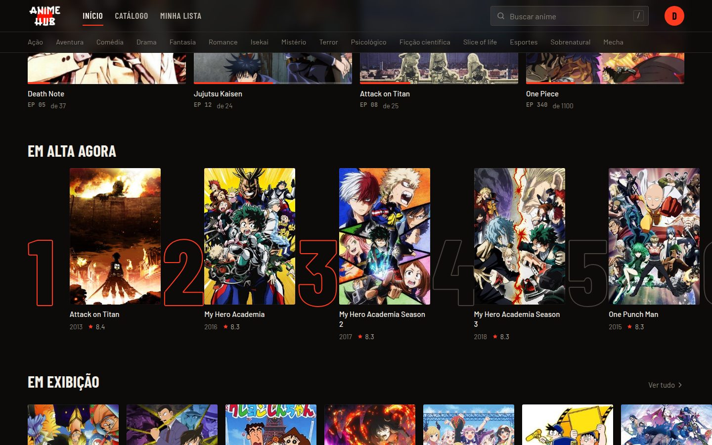
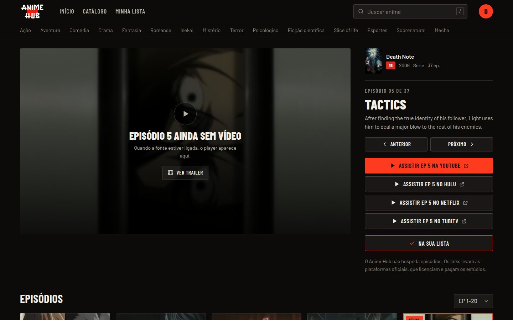
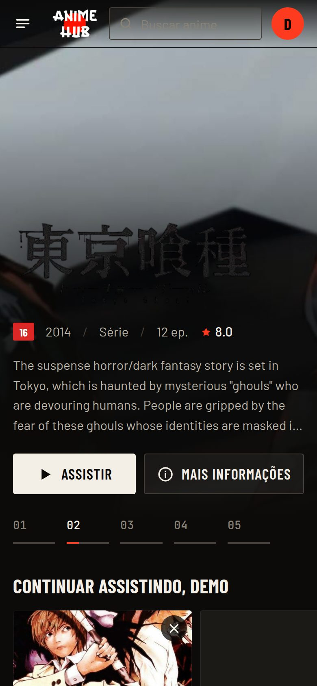

<div align="center">


# AnimeHub

Catálogo de animes com conta de usuário, **Minha lista** e **Continuar assistindo**.


</div>

<br>


## Recursos

- Navegar por fileiras de **Em alta**, **Em exibição** e por gênero (ação, romance, isekai...)
- Buscar qualquer anime e filtrar o catálogo por gênero
- Ver detalhes: sinopse, nota, classificação indicativa, gêneros, trailer e onde assistir oficialmente
- Criar conta e entrar
- Salvar animes na **Minha lista**
- Abrir episódios (com thumbnail e sinopse); o site lembra onde você parou e mostra em **Continuar assistindo**
- Player de episódio pronto no front, com lista de episódios, anterior/próximo e avanço automático (a fonte do vídeo ainda não está ligada, veja [Player](#player))

Os dados dos animes vêm da API pública do [Kitsu](https://kitsu.app). Contas, lista e progresso ficam no nosso banco.

<br>






<p align="center">
  
</p>

<br>

## Como usar o site

### Início
- No topo fica o **destaque**: cinco animes que trocam sozinhos. Passe o mouse em cima pra pausar, ou clique nos números pra escolher um.
- Logo abaixo vêm as fileiras: **Em alta agora** (top 10), **Em exibição** e uma por gênero. Arraste pro lado ou use as setas.
- Depois de entrar na conta, aparece também a fileira **Continuar assistindo**, com o último episódio que você abriu de cada anime. O **×** tira o anime da fileira.

### Buscar e filtrar
- Digite no campo **Buscar anime** do topo. Aperte **/** em qualquer página pra ir direto pra busca.
- No **Catálogo**, os botões de gênero filtram a lista. **Carregar mais** traz mais resultados.
- A barra de gêneros embaixo do header leva direto pro catálogo filtrado.

### Detalhes do anime
Clique em qualquer pôster pra abrir os detalhes: sinopse, nota, classificação indicativa, gêneros e onde assistir oficialmente. Dali dá pra:
- **Assistir**: abre a página do anime. Se você já viu algum episódio, o botão vira **Continuar EP X**.
- **Minha lista**: salva ou remove o anime da sua lista.
- **Trailer**: toca o trailer oficial dentro da janela.

### Assistir
- Na página de assistir ficam o player, o nome do episódio, a sinopse e os botões **Anterior** e **Próximo**.
- Embaixo vem a lista de episódios com thumbnail. Clique num episódio pra trocar sem recarregar a página. Animes longos são divididos em faixas de 20 (EP 1–20, 21–40...).
- Cada episódio que você abre fica salvo no **Continuar assistindo**.
- Sem fonte de vídeo ligada, o player mostra o aviso "ainda sem vídeo" e um botão pro trailer (veja [Player](#player)).

### Conta
- **Entrar → Criar conta**: nome, email e senha com pelo menos 8 caracteres. Você já entra direto depois de criar.
- Assistir, salvar na lista e guardar o progresso pedem login. A sessão dura 7 dias.
- Pra sair, clique na sua inicial no canto do header (no celular, fica no menu ☰) e depois em **Sair**.

### Minha lista
No menu, **Minha lista** mostra todos os animes que você salvou.

<br>

## Como rodar

### 1. Instale o Docker

- **Windows / Mac:** [Docker Desktop](https://www.docker.com/products/docker-desktop/)
- **Linux:** Docker Engine + plugin Compose (`docker compose version` precisa funcionar)

Não precisa instalar PHP, Apache nem MySQL. Tudo roda dentro dos containers.

### 2. Suba o projeto

Dentro da pasta do projeto:

```bash
docker compose up -d --build
```

A primeira vez demora um pouco (baixa as imagens e cria o banco). Depois é rápido.

### 3. Abra no navegador

**http://localhost:8080**

Crie uma conta em **Entrar → Criar conta** e pronto.

<br>

## Comandos úteis

| Comando | Para quê |
|---|---|
| `docker compose up -d` | liga o site |
| `docker compose down` | desliga (as contas continuam salvas) |
| `docker compose down -v` | desliga e **apaga o banco** (começa do zero) |
| `docker compose logs -f web` | ver erros do PHP/Apache |
| `docker compose exec db mariadb -uanimehub -panimehub-dev streaming` | abrir o banco no terminal |

<br>

## Problemas comuns

**A porta 8080 já está em uso**
Troque no `docker-compose.yml`: `"8080:80"` → `"8081:80"` e acesse `localhost:8081`.

**Página em branco ou erro 403 no Linux (Fedora, etc.)**
É o SELinux. Os volumes já têm `:z` no `docker-compose.yml`; se tirou, coloque de volta.

**Mudei o `DDL.sql` e nada aconteceu**
O banco só é criado na primeira vez. Rode `docker compose down -v` e suba de novo.

**Fileiras não carregam**
O site precisa de internet para buscar os animes no Kitsu.

<br>

## Como funciona

```
Navegador ──► Apache (.htaccess)
               ├─ /api/*          ─► backend/public/routes/*.php ─► MariaDB
               ├─ /css /js /img   ─► frontend/static/
               └─ qualquer outra  ─► frontend/index.html (SPA)

Navegador ──► API do Kitsu (catálogo, episódios, trailers)
```

O frontend é uma SPA em JavaScript puro: o `index.html` tem o header e o modal, e cada página é um pedaço de HTML em `frontend/pages/` com sua lógica em `frontend/static/js/pages/`.

### Pastas

```
backend/
  _inc/                  configuração, conexão com o banco, JWT, validação
  public/routes/         rotas da API (login, signup, me, list, progress)
  DDL.sql                cria as tabelas
frontend/
  index.html             casca do site: header, menu do celular, modal
  pages/                 HTML de cada página
  static/css/main.css    todo o visual (cores e fontes no topo do arquivo)
  static/js/app.js       roteador + header
  static/js/kitsu.js     busca dados no Kitsu
  static/js/api.js       fala com o nosso backend
  static/js/ui.js        cards, fileiras, modal, avisos
  static/js/player.js    player do episódio (fonte do vídeo em getEpisodeSource)
  static/js/pages/       lógica de cada página
docker/                  Dockerfile e configuração do Apache
```

### Player

A tela `/watch?id=<kitsu>&ep=<n>` monta o player em `static/js/player.js`. Para cada episódio ela chama:

```js
getEpisodeSource(anime, ep) // -> { url, type: "video" | "iframe" } ou null
```

Hoje essa função devolve `null`, então o player mostra a capa do episódio com o aviso "ainda sem vídeo" e um botão para o trailer. Para ligar vídeos (arquivos próprios, vídeos seus no YouTube, conteúdo licenciado), basta devolver a URL ali:

- `type: "video"`: arquivo direto (`.mp4`, `.webm`) tocado no `<video>` do site; ao terminar, passa para o próximo episódio
- `type: "iframe"`: player embutido

### API

| Rota | Método | Precisa login | O que faz |
|---|---|:---:|---|
| `/api/signup` | POST | | cria a conta e já devolve o token |
| `/api/login` | POST | | devolve `{ token, user }` |
| `/api/me` | GET | ✓ | dados de quem está logado |
| `/api/list` | GET · POST · DELETE | ✓ | Minha lista |
| `/api/progress` | GET · POST · DELETE | ✓ | último episódio de cada anime |

Rotas com login esperam o header `Authorization: Bearer <token>`.

### Banco

| Tabela | Guarda |
|---|---|
| `user` | nome, email e senha (com hash) |
| `watchlist` | animes salvos por usuário |
| `progress` | último episódio aberto de cada anime |

<br>

## Rodar sem Docker (XAMPP/WAMP)

1. Copie a pasta do projeto para `htdocs` e deixe ela como **raiz** do site (o `.htaccess` usa caminhos a partir de `/`)
2. Ative o `mod_rewrite` e `AllowOverride All`
3. Rode o `backend/DDL.sql` no MySQL
4. Ajuste usuário e senha do banco em `backend/_inc/config.php` (ou pelas variáveis `DB_HOST`, `DB_USER`, `DB_PASS`)
